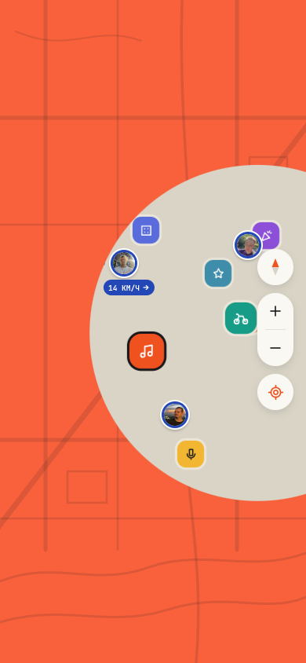
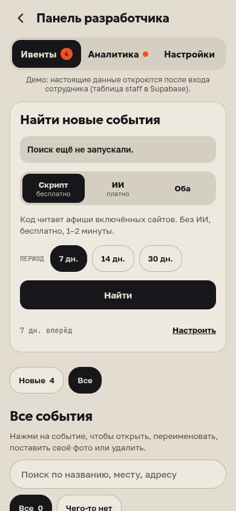

# Исправления после проверки 11–12 октября

Все десять пунктов [отчёта](../../REVIEW-2026-10-12.md) исправлены в коде. Миграция 24 применена в настоящей базе, серверные функции обновлены; финальная APK с настоящими данными (`preview`, `live`) успешно собрана. Сборка разрешена владельцем 12 октября.

- Удалённые и переименованные события учитываются независимо от даты начала; длинные выставки и следующие страницы не теряются.
- Снятые события остаются в планах участников с понятной отметкой. Чужие закрытые планы не открываются.
- Частные встречи нельзя переименовать через функцию публичной афиши.
- Черновики архивируются после окончания, а не удаляются сразу после начала.
- Ненайденный дом не подменяется точкой улицы; второй сервис проверяет именно номер дома.
- Геолокация карты останавливается при уходе, включая поздно созданную подписку. После отказа приложение не повторяет запрос разрешения при смене вкладок.
- Результат сайтов сохраняется без ключа ИИ; список «Все» включает действующие долгие выставки.
- После ошибки старого фото новое загружается.
- Заставка: короткий отскок точки и раскрытие через SVG, без огромной рамки. До входа — 2,6 с; ожидание карты ограничено, максимум 3,2 с. Приближение карты после запуска — 1,22 раза.
- Кнопки панели из замечаний увеличены до 44 pt; режим «Скрипт» не зависит от сохранённого имени модели ИИ.

Проверки: `tsc` приложения и сборщика, `expo lint`, `knip`, 271 тест в 27 наборах, отдельная проверка SQL на локальном PostgreSQL. Проверка SQL исполняет новую миграцию и проверяет участника, постороннего, сотрудника и анонимный доступ. Оба сценария замены фото проверены на настоящем компоненте.

Web-кадры 390×844 сделаны с управляемыми часами браузера. В этих двух проходах ошибок страницы нет; внешняя сеть отключена, данные демонстрационные. Это не проверка карты и жестов на телефоне.

Обновление сервера завершилось успешно: [GitHub Actions](https://github.com/Ponchuchu/ryadom/actions/runs/38183813310), [результат](../../builds/backend-review-20261012-b0a1ef7.json). Первая APK из `b0a1ef7`: [результат](../../builds/apk-review-20261012-b0a1ef7.json).

**Финальная APK из `f71c206`: [скачать и установить](https://expo.dev/artifacts/eas/wZO3A989-0tXNxUDcSw37pqjcPmosDRq82o7B0GYYpw.apk).** Дополнительная правка повторного запроса геолокации включена. Все проверки перед сборкой прошли: [GitHub Actions](https://github.com/Ponchuchu/ryadom/actions/runs/38185330963), [результат](../../builds/apk-review-20261012-f71c206.json).

Создать PR автоматически не удалось: GitHub вернул `GitHub Actions is not permitted to create or approve pull requests`. Это настройка репозитория, а не ошибка APK. [Открыть запрос вручную](https://github.com/Ponchuchu/ryadom/compare/main...review/dev-panel-polish?expand=1); сначала проверить приложение на Android.

Основная ветка автоматически не меняется. Поиск на сервере получает проверенную версию сборщика через `ROBOT_GITHUB_REF=backend-review-20261012-b0a1ef7`; изменения после этого коммита касаются только клиента и диагностики сборки. Расписание поиска не включалось.

После установки на Android нужно проверить холодный запуск, свою точку и луч, жесты, клавиатуру, загрузку фото и вход сотрудника. Эти действия на телефоне в данной среде не проверялись.
